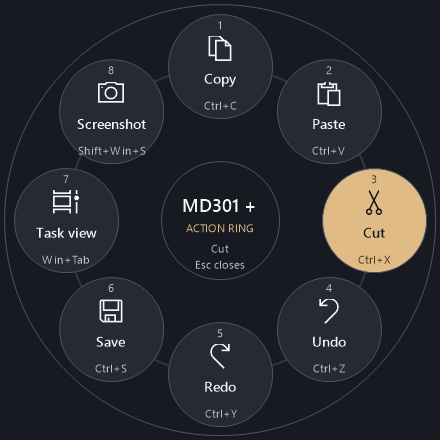

# MD301 Plus

Press a button on your ASUS ProArt MD301 mouse, and a ring of shortcuts opens at
the pointer. Click one to run it.

Free to use. No ads, subscriptions, or in-app purchases.

## Install

**Install normally:** [Download MD301Plus-Setup.exe](https://github.com/HugoMSFT/MD301_Plus/releases/latest/download/MD301Plus-Setup.exe)
and run it. No administrator rights are needed.

**Run without installing:** [Download MD301Plus-Portable.zip](https://github.com/HugoMSFT/MD301_Plus/releases/latest/download/MD301Plus-Portable.zip),
extract it, then double-click `MD301Plus.exe`. It stays in the notification
area while it is running.

Works on Windows 10 and 11. You don't need administrator rights.

GitHub Actions builds and tests each release. The release includes SHA-256
checksums and GitHub build provenance so you can verify the files came from this
repository. The app is not code-signed yet, so Windows may still warn about it:

- **"Windows protected your PC" (SmartScreen):** select **More info**, then
  **Run anyway**.
- **"Smart App Control blocked an app":** Windows 11 can't allow just one app.
  You can turn Smart App Control off, which lowers protection for every app, or
  wait for a signed version. [What to do](docs/GUIDE.md#smart-app-control-blocked-md301-plus)

## Use

1. In settings, pick a mouse button: **Back**, **Forward**, or **Wheel click**.
2. Drag shortcuts from the right onto the ring.
3. Select **Save changes**.

Now press that mouse button. The ring opens at the pointer. Click a shortcut, or
press **Esc** to close the ring.

MD301 Plus keeps running in the notification area of the taskbar. To change your
ring, open **MD301 Plus** from the Start menu.

To use the small DPI button below the scroll wheel instead, follow the
[one-time ASUS Gear Link setup](docs/GUIDE.md#assign-the-below-scroll-dpi-button).

## Uninstall

Open **Settings > Apps > Installed apps**, find **MD301 Plus**, and select
**Uninstall**.

## More

- [Full guide](docs/GUIDE.md): every option, troubleshooting, and how to build
  from source.
- [Report a problem](https://github.com/HugoMSFT/MD301_Plus/issues)
- [Privacy](docs/PRIVACY.md): your settings and logs stay on your PC.

MD301 Plus is an independent project. It isn't made by or affiliated with ASUS.
