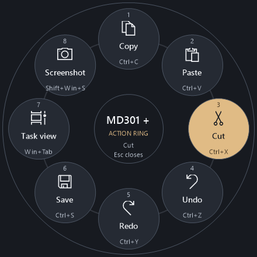

# MD301 Plus

Press a button on your ASUS ProArt MD301 mouse, and a ring of shortcuts opens at
the pointer. Click one to run it.

Free to use. No ads, subscriptions, or in-app purchases.

## Install

**[Get MD301 Plus from the Microsoft Store](https://apps.microsoft.com/detail/9PG3VJDNT81F)**
(recommended). It's free, signed by Microsoft, and updates automatically, so
Windows won't warn about it or block it.

Other options, if you can't use the Store:

- **Installer:** [Download MD301Plus-Setup.exe](https://github.com/HugoMSFT/MD301_Plus/releases/latest/download/MD301Plus-Setup.exe)
  and run it.
- **Run without installing:** [Download MD301Plus-Portable.zip](https://github.com/HugoMSFT/MD301_Plus/releases/latest/download/MD301Plus-Portable.zip),
  extract it, then double-click `MD301Plus.exe`. It stays in the notification
  area while it is running.

Works on Windows 10 and 11. You don't need administrator rights.

The installer and portable downloads are built and tested by GitHub Actions and
include SHA-256 checksums and build provenance, but they are not code-signed, so
Windows may warn about them:

- **"Windows protected your PC" (SmartScreen):** select **More info**, then
  **Run anyway**.
- **"Smart App Control blocked an app":** use the
  [Microsoft Store version](https://apps.microsoft.com/detail/9PG3VJDNT81F)
  instead. [More details](docs/GUIDE.md#smart-app-control-blocked-md301-plus)

## Use

1. In settings, pick a mouse button: **Back**, **Forward**, or **Wheel click**.
2. Drag shortcuts from the right onto the ring.
3. Select **Save changes**.

Now press that mouse button. The ring opens at the pointer. Click a shortcut, or
press **Esc** to close the ring.

The outer circle of the ring shows your mouse's battery level. It fills
clockwise from the top, and turns amber at 20% and red at 10%. If the level
can't be read, for example when the mouse isn't connected through its ASUS USB
receiver, the ring shows **--**.

MD301 Plus keeps running in the notification area of the taskbar. To change your
ring, open **MD301 Plus** from the Start menu.

To use the small DPI button below the scroll wheel instead, follow the
[one-time ASUS Gear Link setup](docs/GUIDE.md#assign-the-below-scroll-dpi-button).

## Uninstall

Open **Settings > Apps > Installed apps**, find **MD301 Plus**, and select
**Uninstall**.

Windows can take a little time to finish removing the Store app. Wait for it to
disappear from the list before trying again. You can first right-click its
notification-area icon and choose **Exit**. Closing Settings alone leaves it running.

## More

- [Full guide](docs/GUIDE.md): every option, troubleshooting, and how to build
  from source.
- [Report a problem](https://github.com/HugoMSFT/MD301_Plus/issues)
- [Privacy](docs/PRIVACY.md): your settings and logs stay on your PC.

MD301 Plus is an independent project. It isn't made by or affiliated with ASUS.
